<p align="center"></p>

# sue-me-audit

An agent skill that audits your codebase the way someone looking to sue you would. It checks 24 common sources of legal exposure across privacy, content, sales, and AI features, marks each one PASS, FAIL, or CAN'T TELL, cites the file and line for every failure, and gives you a ranked fix order.

It reports first and changes nothing. You decide what gets fixed.

**This is a risk screen, not legal advice.** It finds the issues that most often draw demand letters, class actions, and regulator attention so you can fix them or take them to a lawyer. A clean report does not mean you cannot be sued.

**Static by construction: no dependencies, executable code, telemetry, network calls, remote instructions, auto-update, scheduled work, or background behavior.** It reads only the files in its own skill folder and the repo you point it at. Nothing happens until a user or agent invokes it.

## What it checks

| Section | Checks |
|---|---|
| Privacy | Privacy policy completeness (data, AI use, third parties), trackers firing before consent, cookie banner with no reject, health data to analytics, biometrics without consent, unencrypted personal data, public storage buckets, deleted uploads still stored |
| Content | Unlicensed images, no report or takedown route, no DMCA agent, no age gate, missing alt text and basic accessibility |
| Sales | Fake testimonials or urgency, cancelling harder than signing up, trials that charge with no reminder, texts without opt-in, emails with no unsubscribe, personalized pricing with no label |
| AI | Unproven "AI-powered" claims, unlabeled AI output, chatbot with no self-harm response, bot acting as a therapist, bot quoting prices and policies on its own |

Every check has a stable ID (PRIV-01 through AI-05). The full list and what counts as evidence is in [`references/checklist.md`](skills/sue-me-audit/references/checklist.md).

## What you get

1. A scope summary: what the app does, who it serves, what it collects, which third parties it loads.
2. One table per section with verdict, severity (CRITICAL, HIGH, LOW), `file:line` evidence, and a concrete fix for every row.
3. Fails ranked by how likely each is to actually hurt you, weighing how often the issue is pursued, statutory damages, outside visibility, and scale.
4. A fix order with quick wins first and effort tags.
5. A checklist of things the code cannot answer (bucket policies, image licenses, DMCA registration, SMS consent records).

## Install

Clone and copy the skill into Claude Code:

```bash
git clone https://github.com/andrewluxem/sue-me-audit.git
cp -r sue-me-audit/skills/sue-me-audit ~/.claude/skills/
```

Or install it as a Claude Code plugin:

```text
/plugin marketplace add andrewluxem/sue-me-audit
/plugin install sue-me-audit@sue-me-audit
```

Other agents that read `SKILL.md` folders can use `skills/sue-me-audit/` as is.

## Invoke it

Open your agent in the repo you want audited and ask:

```text
Audit this codebase like someone looking to sue me
What in this repo could get me sued?
Run a legal exposure audit before we launch
```

Naming the skill is always valid: `use the sue-me-audit skill`.

## Files

```text
.claude-plugin/
  plugin.json
  marketplace.json
skills/sue-me-audit/
  SKILL.md                         the procedure
  meta.yaml                        version, changelog, test prompts
  LICENSE.md
  references/
    checklist.md                   every check, by ID
    severity-and-ranking.md        severity scale and ranking method
    legal-hooks.md                 laws each check usually maps to
  assets/
    report-template.md             exact report layout
CONTRIBUTING.md
CHANGELOG.md
README.md
LICENSE
```

## Contributing

This checklist is meant to get better in public. The most useful contributions are:

- **Missed issues:** the audit passed something it should have failed. Open a "False pass" issue.
- **Wrong flags:** the audit failed something that was fine. Open a "False fail" issue.
- **New checks:** a real source of legal exposure the list does not cover. Open a "New check" issue with a source.
- **Sources:** primary-source links for the rows in [`legal-hooks.md`](skills/sue-me-audit/references/legal-hooks.md).

Start with [CONTRIBUTING.md](CONTRIBUTING.md). Never paste secrets, customer data, or private code into an issue.

## Versioning

Plugin installation is version-pinned. When behavior changes, update the version consistently in `SKILL.md`, `meta.yaml`, `.claude-plugin/plugin.json`, and `.claude-plugin/marketplace.json`, then add a `CHANGELOG.md` entry. Reinstalling is an explicit update; this repository never auto-updates itself.

## License

MIT. See [LICENSE](LICENSE). The skill folder carries the same authorization in [skills/sue-me-audit/LICENSE.md](skills/sue-me-audit/LICENSE.md).

---

Part of [andrewluxem/playbooks](https://github.com/andrewluxem/playbooks), a free library of practical playbooks and agent skills.
